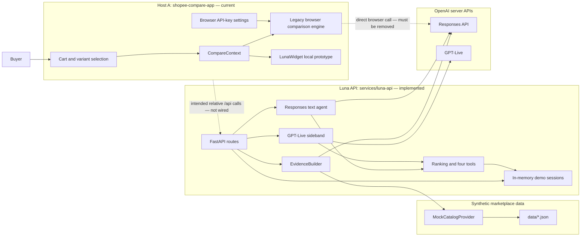
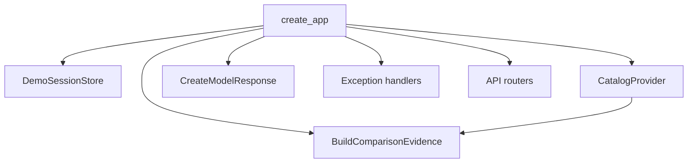
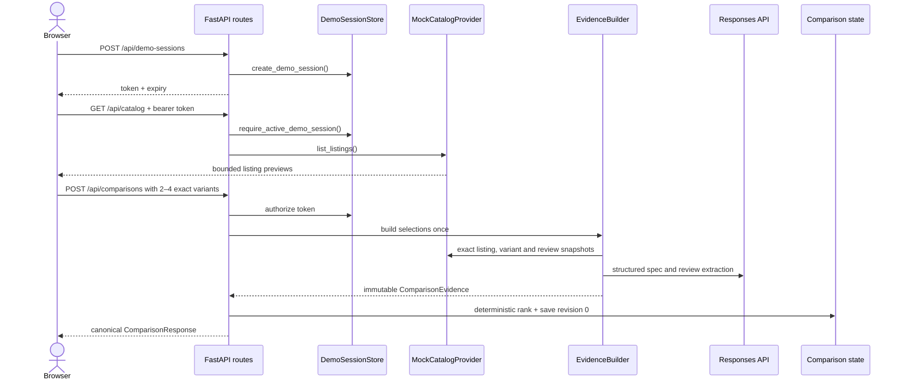
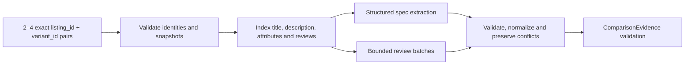
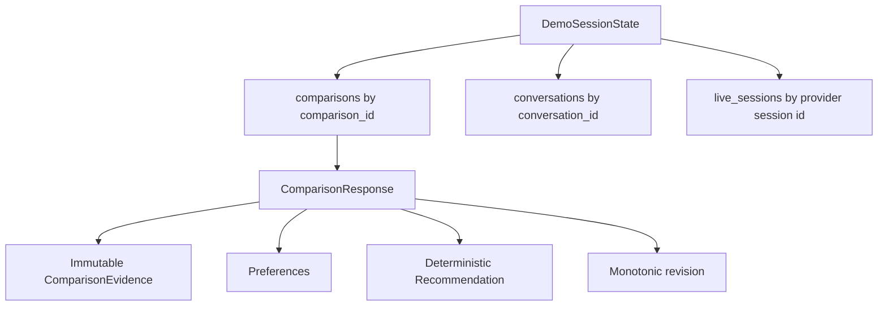
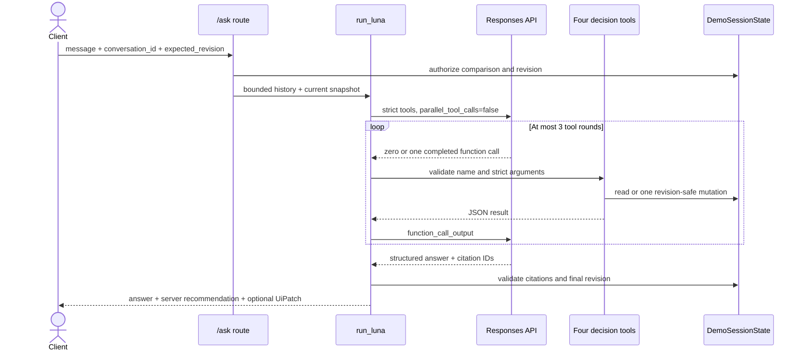
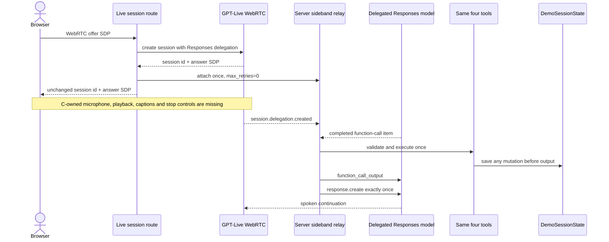
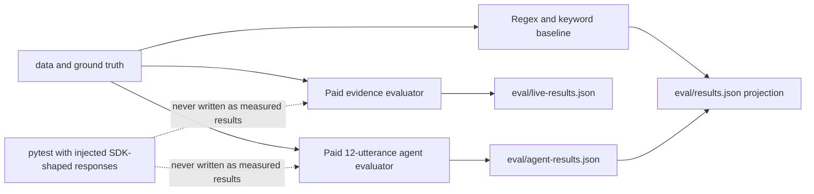

# Luna architecture

This document explains how Luna works today, how data moves through it, and where the
remaining integration gaps are. Start with [user-stories.md](user-stories.md) for the
plain-language product flow, read [invariants.md](invariants.md) for rules that code must not
break, and read [decisions.md](decisions.md) for the reasons behind the design.

## Current status — read this first

The repository contains two different levels of completion:

- **Implemented and tested:** the Python API, synthetic catalog provider, evidence pipeline,
  deterministic ranking, session state, four decision tools, Responses text agent, GPT-Live
  server sideband, and evaluation runners.
- **Not integrated:** `shopee-compare-app` still owns a separate browser comparison engine.
  Its `LunaWidget` is a local prototype, and `src/compare/engine.js` still contains a direct
  browser request to OpenAI. It does not call the Luna API.
- **Missing:** the independent Host B, browser WebRTC voice controls, root E2E command,
  single-image runtime, and deployment files.

Do not interpret the backend diagrams as proof that the current frontend uses the backend.
That boundary remains the G2 integration blocker.

## System map



## Repository responsibilities

| Area | Owner | Primary paths | Responsibility |
|---|---|---|---|
| Host A | C | `shopee-compare-app/` | Cart, compare UI, evidence/review presentation, eventual API client and voice controls |
| HTTP/API composition | B | `services/luna-api/app/main.py`, `app/routes/`, `app/errors.py` | Authentication boundary, routes, dependency wiring, stable error envelope |
| Mutable decision state | B | `app/decision/`, `app/contracts/session.py` | Demo sessions, comparisons, preferences, ranking, revisions and tools |
| Immutable evidence | A | `app/evidence/`, `app/contracts/evidence.py` | Exact-variant extraction, normalization, citations and review analysis |
| Marketplace boundary | A | `app/providers/` | Catalog protocol and labelled synthetic provider |
| OpenAI decision boundary | B | `app/openai/` | Bounded Responses loop and Live sideband executor |
| Evaluation | A + B | `eval/` | Evidence metrics, paid evidence run, B's agent benchmark and honest artifacts |
| Delivery | B after C handoff | `Makefile`, future `Dockerfile`, future `render.yaml` | Commands and eventual single-service runtime |

## API composition root

`app.main.create_app` is the only composition root. It creates or accepts:

1. one process-local `DemoSessionStore`;
2. one `CatalogProvider` — currently only `MockCatalogProvider`;
3. one evidence builder — real `EvidenceBuilder + OpenAIModelClient` by default;
4. optional injected text-model transport used only by tests;
5. one shared HTTP error boundary; and
6. the health, session, catalog and comparison routers.

Business code does not reach around these public interfaces. Tests inject at the composition
root or at the model-call boundary; shipped runtime has no fake-provider switch for model
answers.



## Core HTTP journey

All protected routes use the same opaque bearer token. The server owns its one-hour expiry.
A missing, unknown or expired token never reveals whether another session owns a comparison.

| Method | Route | Effect |
|---|---|---|
| `GET` | `/api/health` | Process liveness only |
| `POST` | `/api/demo-sessions` | Creates an opaque process-local session |
| `GET` | `/api/catalog` | Returns bounded catalog previews and exact variants |
| `POST` | `/api/comparisons` | Builds immutable evidence once and stores revision `0` |
| `GET` | `/api/comparisons/{id}` | Returns the latest authorized comparison state |
| `POST` | `/api/comparisons/{id}/ask` | Runs one bounded text-agent turn |
| `POST` | `/api/comparisons/{id}/live/session` | Creates Live WebRTC transport and attaches one server sideband |



## Evidence pipeline

Evidence is immutable after comparison creation. A preference change never re-extracts a
listing and never alters citations.



Important details:

- An item identity is always `listing_id:variant_id`; sibling variants are never silently
  substituted.
- A supported fact needs a value and evidence. Missing, conflicting and unresolved facts do
  not assert a value.
- Review excerpts must be literal substrings from exact-variant review sources.
- Provider/model partial failures become explicit unresolved analysis. They never select an
  offline answer or a second model.
- Source text stays server-side. Decision tools expose bounded normalized facts or explicitly
  requested evidence.

## Mutable comparison state

`DemoSessionState` is the only owner of mutable buyer state.



`apply_preferences` is the only comparison mutation. It requires the caller's
`expected_revision`, calculates a deterministic recommendation, increments the revision once,
and returns a revision-guarded `UiPatch`. A stale request fails before mutation.

## Deterministic decision layer

Ranking applies operations in this order:

1. validate price and supported numeric facts;
2. enforce hard budget and minimum-output constraints;
3. separate candidates whose required facts are uncertain;
4. apply ordered objective priorities lexicographically;
5. refuse a winner when there is no objective priority or when top candidates tie.

Review reliability is explanatory evidence, not a numeric score.

The model can access exactly four functions:

| Tool | Reads or writes | Boundary |
|---|---|---|
| `get_comparison` | Read | Compact facts, preferences and recommendation; no raw pages |
| `get_review_aspect` | Read | One aspect, bounded item set and literal mentions |
| `inspect_evidence` | Read | Exact stored evidence IDs only |
| `apply_preferences` | **Write** | The only mutation; revision checked |

## Responses text-agent flow

The server, not the browser, owns the model request and tool execution.



One text turn makes at most four provider calls: the initial request plus three continuations.
SDK retries are disabled. A timeout after a completed mutation returns a non-retryable error
that tells the client to refresh instead of repeating the action.

## GPT-Live flow

The backend half is implemented; the browser half is not wired in Host A.



The sideband ignores argument deltas, deduplicates call IDs, permits at most three sequential
tool rounds per delegation, and is the only Live tool executor. A successful mutation refreshes
the delegated tool schema to the new revision.

## Errors and failure ownership

Lower layers raise typed failures. `app.errors` is the one HTTP error boundary and maps them to
the stable envelope:

```json
{
  "error": {
    "code": "STALE_COMPARISON",
    "message": "...",
    "retryable": false,
    "current_revision": 2
  }
}
```

Programmer errors and unknown catalog error codes are not converted into plausible user data;
they raise. Expected provider/model failures either return an explicit unresolved result or a
typed API failure. A failed external call never selects another model or architecture.

## Evaluation and verification



- `make api-test` is deterministic and makes no provider calls.
- `make eval` runs the deterministic evaluator and projects a current, hash-validated paid
  agent artifact when one exists.
- Paid evaluators require an explicit `--live`, use no retries and enforce request ceilings.
- Missing metrics stay unavailable rather than becoming zero.
- As of 31 October 2026, the first paid agent run used 28 of 44 allowed requests and passed
  10 of 12 scenarios. It was not retried; failures remain in the artifact.

## Local operation

From the repository root:

```bash
make api-sync
set -a
. ./.env
set +a
make api-dev
```

The service listens on `127.0.0.1:8000` in development. Required server variables are
`OPENAI_API_KEY`, `OPENAI_TEXT_MODEL` and `OPENAI_LIVE_MODEL`. The browser must never receive
the API key.

Current verified commands:

```bash
make api-test
make eval
make api-capability-smoke  # paid
```

`make test`, `make e2e`, `make test-live`, `make demo`, `Dockerfile` and `render.yaml` are not
implemented yet. Do not infer deployment readiness from backend test success.

## Required next integration

The next system-level milestone is not another backend feature. C must replace the legacy
browser comparison path with the API journey:

1. issue one demo session;
2. load `/api/catalog`;
3. create a comparison from exact variant IDs;
4. render the returned evidence and recommendation without recomputation;
5. send text intent to `/ask` with the current revision;
6. reject stale UI patches;
7. delete the browser API-key settings and direct OpenAI call; and
8. mount the same widget in an independent Host B.

Only after that path passes can E2E, voice UI, optional seller reporting, Docker and deployment
be represented as working system features.
