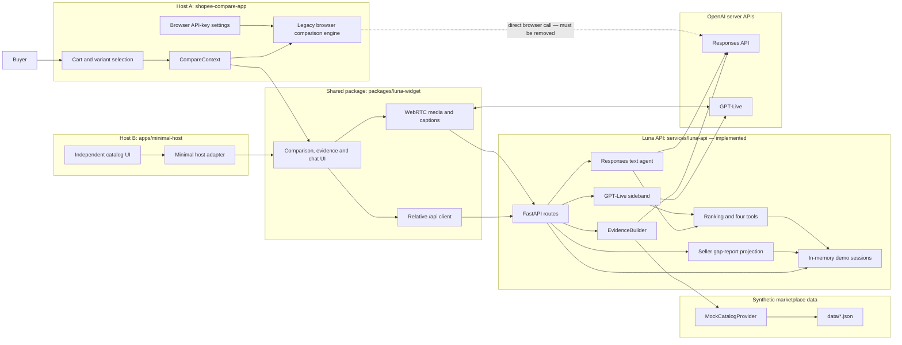
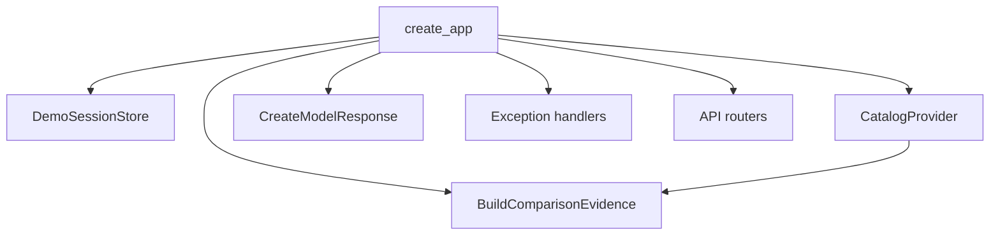
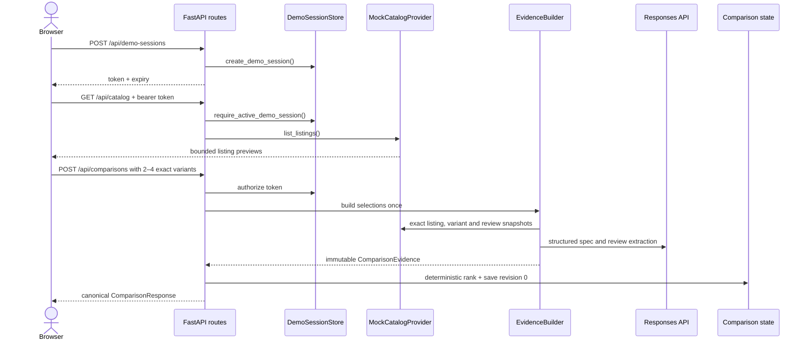
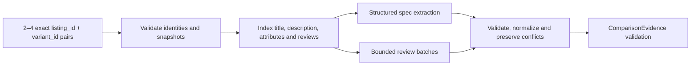
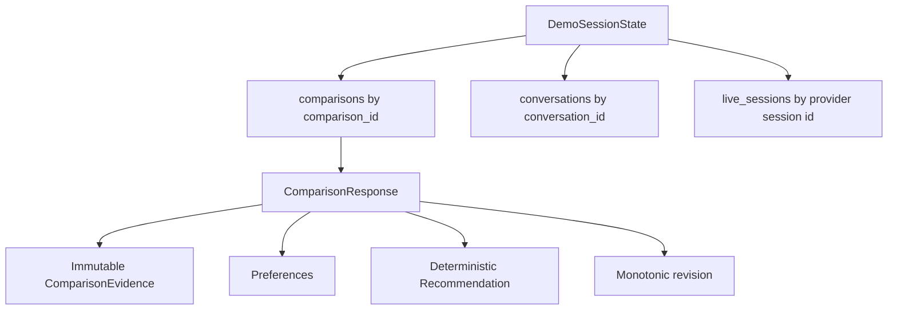
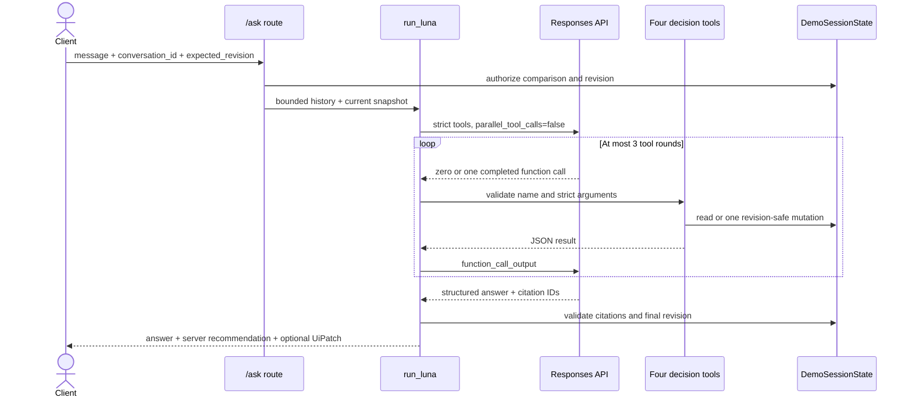
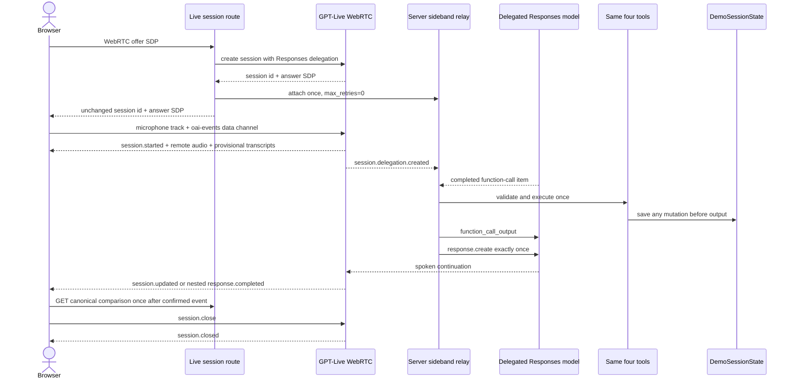
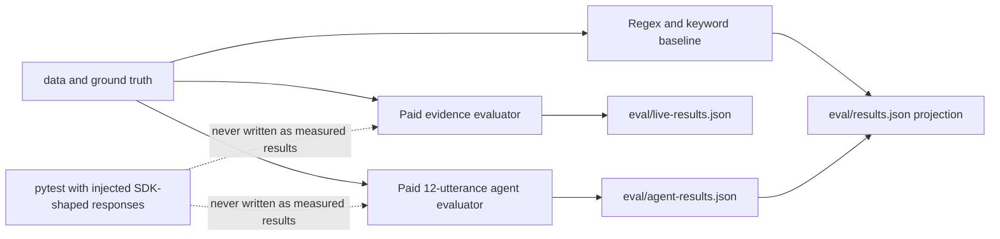

# Luna architecture

This document explains how Luna works today, how data moves through it, and where the
remaining integration gaps are. Start with [user-stories.md](user-stories.md) for the
plain-language product flow, read [invariants.md](invariants.md) for rules that code must not
break, and read [decisions.md](decisions.md) for the reasons behind the design.

## Current status — read this first

The repository contains three different levels of completion:

- **Implemented and tested:** the Python API, synthetic catalog provider, evidence pipeline,
  deterministic ranking, session state, four decision tools, Responses text agent, GPT-Live
  server sideband, evaluation runners, and the session-scoped seller gap-report API. The current
  paid agent artifact is projected by `make eval` and remains honestly partial at 10/12
  scenarios.
- **G3 implemented and deterministic E2E green:** `packages/luna-widget` owns the API client,
  comparison UI, evidence/citation rendering and Live controls. Host A and the independent
  `apps/minimal-host` mount that same package through separate adapters. `make e2e` runs the
  same two-turn comparison journey in both hosts and an import-boundary check.
- **G4 browser path implemented, real gate pending:** the widget negotiates WebRTC, waits for
  `session.started`, plays remote audio, renders provisional input/output captions, refreshes
  canonical state after confirmed Live events, and gracefully closes on `session.closed`.
  Offline Playwright covers that wiring and microphone-denied text fallback. A real paid
  microphone → GPT-Live → sideband tool → revision change has not been run on this branch, so
  G4 is not claimed passed.
- **Replacement/deployment incomplete:** the old compare engine still exists beside Luna and
  `src/compare/engine.js` still contains a direct browser OpenAI request. Seller gap-report UI,
  the single-image runtime, deployment files and public smoke proof remain missing.

The backend no longer blocks C. The next frontend root-cause fix is deleting the parallel
legacy comparison/model path after the canonical widget becomes Host A's only compare owner.

## System map



## Repository responsibilities

| Area | Owner | Primary paths | Responsibility |
|---|---|---|---|
| Host A | C | `shopee-compare-app/` | Shopee-style shell, routes and host adapter |
| Shared widget | C | `packages/luna-widget/` | Comparison UI, API client, evidence/citations and WebRTC media |
| Host B | C | `apps/minimal-host/` | Independent layout, catalog UI and host adapter for portability proof |
| Frontend workspace/test gate | C | `package.json`, `package-lock.json`, `playwright.config.js` | One dependency lock, both builds and dual-host browser tests |
| HTTP/API composition | B | `services/luna-api/app/main.py`, `app/routes/`, `app/errors.py` | Authentication boundary, routes, dependency wiring, stable error envelope |
| Mutable decision state | B | `app/decision/`, `app/contracts/session.py` | Demo sessions, comparisons, preferences, ranking, revisions and tools |
| Immutable evidence | A | `app/evidence/`, `app/contracts/evidence.py` | Exact-variant extraction, normalization, citations and review analysis |
| Marketplace boundary | A | `app/providers/` | Catalog protocol and labelled synthetic provider |
| OpenAI decision boundary | B | `app/openai/` | Bounded Responses loop and Live sideband executor |
| Evaluation | A + B | `eval/` | Evidence metrics, paid evidence run, B's agent benchmark and honest artifacts |
| Delivery | B after C handoff | `Makefile`, future `Dockerfile`, future `render.yaml` | Commands and eventual single-service runtime |

## API composition root

`app.main.create_app` is the only composition root. It creates or accepts:

1. one process-local `DemoSessionStore`;
2. one `CatalogProvider` — currently only `MockCatalogProvider`;
3. one evidence builder — real `EvidenceBuilder + OpenAIModelClient` by default;
4. optional injected text-model transport used only by tests;
5. one shared HTTP error boundary; and
6. the health, session, catalog, listing-report and comparison routers.

Business code does not reach around these public interfaces. Tests inject at the composition
root or at the model-call boundary; shipped runtime has no fake-provider switch for model
answers.



## Core HTTP journey

All protected routes use the same opaque bearer token. The server owns its one-hour expiry.
A missing, unknown or expired token never reveals whether another session owns a comparison.

| Method | Route | Effect |
|---|---|---|
| `GET` | `/api/health` | Process liveness only |
| `POST` | `/api/demo-sessions` | Creates an opaque process-local session |
| `GET` | `/api/catalog` | Returns bounded catalog previews and exact variants |
| `POST` | `/api/comparisons` | Builds immutable evidence once and stores revision `0` |
| `GET` | `/api/comparisons/{id}` | Returns the latest authorized comparison state |
| `POST` | `/api/comparisons/{id}/ask` | Runs one bounded text-agent turn |
| `POST` | `/api/comparisons/{id}/live/session` | Creates Live WebRTC transport and attaches one server sideband |



## Evidence pipeline

Evidence is immutable after comparison creation. A preference change never re-extracts a
listing and never alters citations.



Important details:

- An item identity is always `listing_id:variant_id`; sibling variants are never silently
  substituted.
- A supported fact needs a value and evidence. Missing, conflicting and unresolved facts do
  not assert a value.
- Review excerpts must be literal substrings from exact-variant review sources.
- Provider/model partial failures become explicit unresolved analysis. They never select an
  offline answer or a second model.
- Source text stays server-side. Decision tools expose bounded normalized facts or explicitly
  requested evidence.

## Mutable comparison state

`DemoSessionState` is the only owner of mutable buyer state.



`apply_preferences` is the only comparison mutation. It requires the caller's
`expected_revision`, calculates a deterministic recommendation, increments the revision once,
and returns a revision-guarded `UiPatch`. A stale request fails before mutation.

## Deterministic decision layer

Ranking applies operations in this order:

1. validate price and supported numeric facts;
2. enforce hard budget and minimum-output constraints;
3. separate candidates whose required facts are uncertain;
4. apply ordered objective priorities lexicographically;
5. refuse a winner when there is no objective priority or when top candidates tie.

Review reliability is explanatory evidence, not a numeric score.

The model can access exactly four functions:

| Tool | Reads or writes | Boundary |
|---|---|---|
| `get_comparison` | Read | Compact facts, preferences and recommendation; no raw pages |
| `get_review_aspect` | Read | One aspect, bounded item set and literal mentions |
| `inspect_evidence` | Read | Exact stored evidence IDs only |
| `apply_preferences` | **Write** | The only mutation; revision checked |

## Responses text-agent flow

The server, not the browser, owns the model request and tool execution.



One text turn makes at most four provider calls: the initial request plus three continuations.
SDK retries are disabled. The agent reads required evidence before mutation. After
`apply_preferences` succeeds, the continuation uses `tool_choice: "none"`; the provider can
only produce the final answer. Any invalid response after the committed mutation returns the
new revision in a non-retryable error so the client refreshes instead of repeating the action.

## GPT-Live flow

The backend and browser transport halves are implemented. The real provider-driven spoken
mutation is still a manual paid acceptance gate.



The sideband ignores argument deltas, deduplicates call IDs, permits at most three sequential
tool rounds per delegation, and is the only Live tool executor. The browser never executes a
tool. It refreshes canonical state only after a confirmed session/backend lifecycle event, not
on provisional transcript fragments. A successful mutation refreshes the delegated tool schema
to the new revision.

## Errors and failure ownership

Lower layers raise typed failures. `app.errors` is the one HTTP error boundary and maps them to
the stable envelope:

```json
{
  "error": {
    "code": "STALE_COMPARISON",
    "message": "...",
    "retryable": false,
    "current_revision": 2
  }
}
```

Programmer errors and unknown catalog error codes are not converted into plausible user data;
they raise. Expected provider/model failures either return an explicit unresolved result or a
typed API failure. A failed external call never selects another model or architecture.

## Evaluation and verification



- `make api-test` is deterministic and makes no provider calls.
- `make eval` runs the deterministic evaluator and projects a paid agent artifact only when its
  evidence, scenario suite and text-agent implementation hashes are current.
- Paid evaluators require an explicit `--live`, use no retries and enforce request ceilings.
- Missing metrics stay unavailable rather than becoming zero.
- As of 31 October 2026, the authorized current-agent run used 28 of 44 allowed requests and
  passed 10 of 12 scenarios. It was not retried; failures remain in the artifact. The current
  projection reports `available: true`, `status: partial`.

## Local operation

From the repository root:

```bash
make api-sync
set -a
. ./.env
set +a
make api-dev
```

The service listens on `127.0.0.1:8000` in development. Required server variables are
`OPENAI_API_KEY`, `OPENAI_TEXT_MODEL` and `OPENAI_LIVE_MODEL`. The browser must never receive
the API key.

Current verified commands:

```bash
make api-test
make eval
make frontend-build
make e2e
make api-capability-smoke  # paid capability check
```

`make e2e` is deterministic: it injects SDK-shaped text responses, uses a browser WebRTC test
double, starts both independent hosts and makes no provider call. It is not proof of real
microphone/provider audio. `make test`, `make test-live`, `make demo`, `Dockerfile` and
`render.yaml` are not implemented. Do not infer deployment or G4 readiness from offline tests.

## Required next integration

The next system-level milestone is not another backend feature. G3 is automated and the G4
browser path exists. The remaining ordered work is:

1. make Host A's main compare journey use the canonical API selection instead of keeping a
   separate synthetic Luna catalog beside the legacy comparison;
2. delete the browser API-key settings, direct OpenAI call and independent ranking path;
3. render the seller gap-report in both hosts from B's existing endpoint;
4. authorize and run one real local microphone → Live tool → revision proof; cut voice from the
   main demo if that check fails; and
5. add the single-origin runtime and deployment only after the canonical Host A replacement.

Do not represent the legacy Host A replacement, real voice mutation, seller UI, Docker or
deployment as complete before their individual gates pass.
