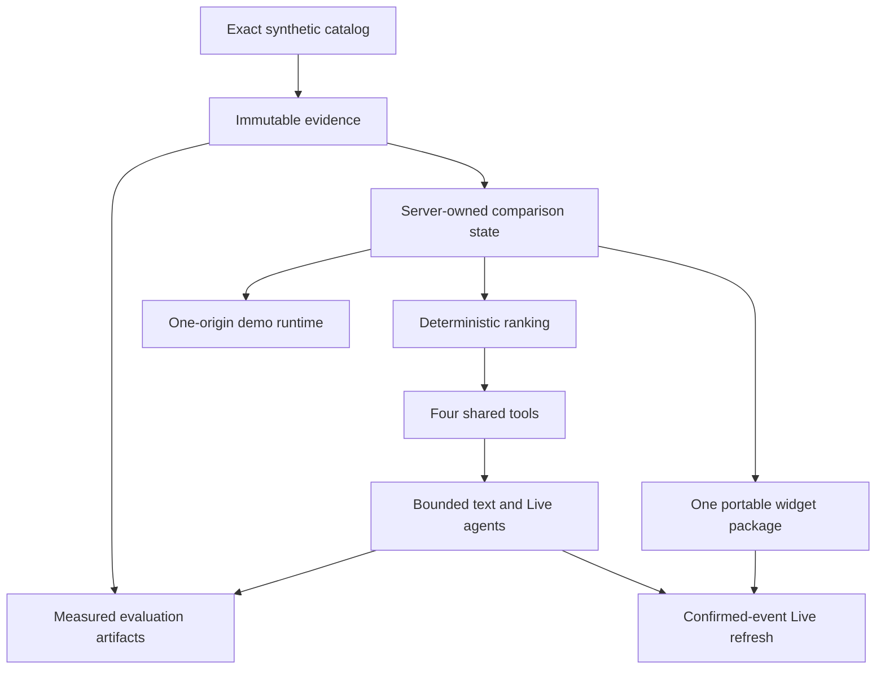

# Luna architectural decisions

This is the compact decision log for choices that shape multiple modules. It records decisions,
not implementation progress. See [architecture.md](architecture.md) for the system map and
[invariants.md](invariants.md) for the rules derived from these choices.

## Decision map

## Summary

| ID | Status | Decision |
|---|---|---|
| D-01 | Accepted | Use a labelled synthetic marketplace provider; never fake live Shopee access |
| D-02 | Accepted | Exact variant identity is mandatory at every boundary |
| D-03 | Accepted | Evidence is immutable; buyer decision state is mutable and separately owned |
| D-04 | Accepted | Deterministic code owns filtering/ranking; models gather intent and evidence |
| D-05 | Accepted | Expose exactly four decision tools, with one mutating tool |
| D-06 | Accepted | Use Responses for text with strict tools and bounded continuations |
| D-07 | Accepted | Use GPT-Live Responses delegation with one server-side executor |
| D-08 | Accepted | Disable SDK retries and alternate-strategy fallbacks |
| D-09 | Accepted for demo | Store opaque demo sessions in one process with no database |
| D-10 | Accepted | Use stable typed HTTP errors and one error boundary |
| D-11 | Accepted | Separate deterministic tests from explicitly paid evaluation artifacts |
| D-12 | Accepted | Keep evidence and agent paid request budgets separate |
| D-13 | Planned, not implemented | Serve both hosts and API from one Docker image and origin |
| D-14 | Rejected and removed | Browser-owned OpenAI keys and independent browser ranking |
| D-15 | Accepted for demo | Project seller listing gaps from current authorized session state |
| D-16 | Accepted and implemented | Use one widget package, two host adapters and one root npm lock |
| D-17 | Accepted and implemented | Refresh Live UI after confirmed events; never mutate from captions |

## D-01 — Labelled synthetic marketplace provider

**Decision:** The demo uses `MockCatalogProvider` and fabricated listings/reviews. Unsupported
provider names fail explicitly.

**Why:** The team has no verified Shopee API authorization, and the hackathon must demonstrate
the workflow without scraping or inventing access.

**Consequences:**

- Product/business claims are workflow demonstrations, not production marketplace results.
- Provider protocols remain real integration boundaries.
- A future authorized provider replaces the mock through the same interface; it is not a
  fallback selected after mock failure.

## D-02 — Exact variant identity

**Decision:** Selection and evidence use `(listing_id, variant_id)` and the derived
`listing_id:variant_id` item key.

**Why:** Marketplace listings contain sibling variants whose specifications differ. Listing-level
identity would silently leak values between SKUs.

**Consequences:** Unknown variants fail. Reviews without an exact variant are excluded from
exact-SKU summaries. The UI must make the selected variant visible.

## D-03 — Immutable evidence, mutable decision state

**Decision:** A's `ComparisonEvidence` is frozen after creation. B separately owns preferences,
recommendation, conversation and revision.

**Why:** A buyer correction should change the decision, not rewrite what the listing or reviews
said. This also prevents re-extraction on every chat turn.

**Consequences:** `apply_preferences` reuses the same evidence object. Fresh marketplace evidence
requires a new comparison. Dashboards and reports are projections, not another truth store.

## D-04 — Deterministic ranking

**Decision:** Hard constraints and lexicographic priorities run in Python. The model never emits
the authoritative winner.

**Why:** Budget/power filtering and revision behavior must be reproducible, inspectable and safe
under missing facts.

**Consequences:** The model can translate language into preferences and explain results. It cannot
score missing facts, turn review sentiment into an unsupported number or override the result.

## D-05 — Four tools, one mutation

**Decision:** Text and Live share `get_comparison`, `get_review_aspect`, `inspect_evidence` and
`apply_preferences`. Only the last one writes.

**Why:** One executor and one mutation path make authority, validation and stale-turn behavior
obvious.

**Consequences:** New reads should normally extend an existing bounded response rather than add a
general plugin/tool framework. A new mutation requires an explicit architecture decision.

## D-06 — Bounded Responses text agent

**Decision:** Use the Responses API with strict functions, `parallel_tool_calls=false`, at most
three tool rounds, at most four provider calls, and validated structured final text. Gather
evidence before mutation; after `apply_preferences`, force the final continuation with
`tool_choice: "none"`.

**Why:** This preserves agentic intent handling while bounding cost, latency and duplicate action
risk.

**Consequences:** SDK retries are zero. A tool-limit or provider failure is explicit. No tool can
run after a committed text mutation. A post-mutation contract failure exposes the saved revision
and is non-retryable. Conversation history stores only four successful turns.

## D-07 — GPT-Live with one server sideband

**Decision:** Live uses `gpt-live-1` for conversation and Responses delegation for backend work.
The server sideband is the only tool executor.

**Why:** Text and voice must produce the same state through the same validated functions. Running
tools in both browser and server would duplicate mutations.

**Consequences:** The browser owns WebRTC media only. The sideband waits for completed calls,
deduplicates IDs, saves state before output and resumes with one `response.create`.

## D-08 — No retries or strategy fallback

**Decision:** Every OpenAI client uses `max_retries=0`. A failed call does not choose another
model, offline answer, browser executor or architecture.

**Why:** Hidden retries make call ceilings, latency and mutation semantics unreliable. Alternate
strategies can quietly change behavior under failure.

**Consequences:** Expected failures are typed and visible. Independent evaluation scenarios may
continue after one measured failure, but the failed scenario itself is never retried or repaired.

## D-09 — Process-local demo sessions

**Decision:** Use opaque one-hour bearer tokens and an in-memory store in one API process.

**Why:** A database, worker or distributed session system adds no value to a short-lived demo.

**Consequences:** Restarting the process clears sessions. Multiple workers would not share state.
This is acceptable only for the declared single-process demo.

## D-10 — One typed HTTP error boundary

**Decision:** Domain/provider/model layers raise typed failures. `app.errors` alone chooses public
status, code, wording and retryability.

**Why:** Duplicated catches create inconsistent client behavior and can leak internal values.

**Consequences:** Unknown error codes and broken invariants raise instead of becoming a generic
success or invented default.

## D-11 — Tests and measured evaluation are separate

**Decision:** Ordinary tests inject concrete SDK-shaped outputs and spend no credits. Only CLIs
requiring explicit `--live` may write measured artifacts.

**Why:** A fake transport is useful for behavior tests but cannot support a model-quality claim.

**Consequences:** Missing live metrics remain unavailable. Paid artifacts include limitations,
request counts, usage coverage and evidence/scenario/implementation hashes. Failed measured
scenarios remain visible. A source change makes the prior agent artifact historical and the
current projection unavailable until a newly authorized run.

## D-12 — Separate evidence and agent request budgets

**Decision:** A's evidence evaluator retains its 36-request ceiling. B's 12-utterance agent
evaluator has a separate 44-request ceiling and artifact.

**Why:** The workloads have different owners, acceptance criteria and call shapes. Combining the
budgets would obscure which operation spent credits or failed.

**Consequences:** `eval/live-results.json` owns evidence measurements;
`eval/agent-results.json` owns agent measurements. `eval.run` validates and projects only a
current agent artifact into `eval/results.json`; it does not rerun or rewrite the agent
measurement.

## D-13 — One-origin demo deployment

**Status:** Planned, not implemented.

**Decision:** Build both frontend hosts, copy them into one FastAPI image, serve Host B under
`/minimal`, mount Host A last at `/`, and call relative `/api` routes.

**Why:** One service is the smallest deployable demo and removes CORS and split configuration.

**Consequences:** Both build outputs and cross-host E2E now exist. Docker/deployment still needs
an explicit approved implementation and public smoke proof; frontend/backend readiness alone is
not deployment readiness.

## D-14 — Browser-owned model access is rejected

**Decision:** The legacy frontend API-key field, direct `api.openai.com` request and independent
browser ranking are superseded by the server API architecture.

**Why:** They expose credentials, duplicate evidence/ranking authority and prevent consistent
text/voice behavior.

**Consequences:** The former `shopee-compare-app/src/compare` implementation is deleted rather
than retained as a fallback. Host A mounts the shared widget directly, and Playwright asserts
that the old directory, browser model-key UI and direct OpenAI request do not return. The cart
never invents a mapping from clone product IDs to trusted catalog IDs; D-19 replaces the clone
rows with catalog variants instead.

## D-15 — Seller insights are a read-only session projection

**Superseded in part by D-18:** the report now reads every active session and lives on a
separate seller page. The read-only, zero-model-call and no-buyer-data rules below still hold.

**Decision:** The seller gap report is computed on request from current comparisons in the
authorized demo session. Ranking records structured exclusion and uncertainty reasons once;
those seller-only fields are excluded from existing comparison and agent serialization.

**Why:** This creates the operations half of the demo from evidence and decisions Luna already
owns, without another model call, duplicated ranking logic, buyer-data exposure, history table
or second source of truth.

**Consequences:** One report request performs one catalog existence lookup and reads at most ten
comparisons with four items each. It does not show a buyer identity, conversation, budget or
preferences. Counts describe current comparison states in this process, not weekly analytics.
Restarting clears them. The shared widget renders the report without recomputing its counts and
reuses the comparison evidence panel for conflict sources. Seller authentication, listing
ownership, cross-session aggregation and week-over-week history remain future integration work.

## D-16 — One portable widget package and one dependency lock

**Decision:** `packages/luna-widget` owns the Luna API client, comparison/evidence/chat UI and
Live controls. Host A and Host B supply separate `LunaHostAdapter` implementations and import
the package; the package imports neither host. The repository root owns npm workspaces and the
only JavaScript lockfile.

**Why:** Copying UI or letting the widget reach into storefront state would make portability a
claim rather than an invariant. Multiple lockfiles would let the two hosts resolve different
versions of the supposedly same package.

**Consequences:** Host-specific routing and selection stay outside the package. `make
frontend-build` builds both hosts, and `make e2e` runs the same decision flow plus an
import-boundary check. A real Shopee integration still needs authorized product identity,
session, performance and security work. Product views receive one widget-projected canonical
snapshot with the server-owned price breakdown, all normalized facts and exact existing evidence
excerpts/locations. Hosts render it but do not fetch, calculate, infer or recite product data
independently.

## D-17 — Confirmed-event Live refresh, not transcript mutation or endless polling

**Decision:** The browser treats `session.input_transcript.delta` and
`session.output_transcript.delta` as provisional captions only. It fetches canonical comparison
state after `session.updated` or a nested `response.completed`, with at most one refresh in
flight. The server sideband remains the sole tool executor.

**Why:** A transcript fragment is not a committed preference, while continuous one-second
polling creates unbounded calls for a long voice session. Confirmed lifecycle events give the
browser a bounded trigger without introducing a second push service or state owner.

**Consequences:** Offline Playwright proves offer/readiness/captions/mute/close wiring and the
permission-denied text fallback. The one authorized real run produced captions and a newer
canonical revision but no audible output. It was not retried. G4 therefore failed and voice is
removed from the main demo rather than replaced by a second architecture.

## D-18 — Seller insights live in Seller Centre and count every active buyer session

**Decision:** The buyer widget shows no seller UI. Host A's top-bar **Seller Centre** link opens
`#/SellerCentre`, which mounts the widget package's `SellerGapReport`. The gap-report route
aggregates current comparisons from every active demo session, not only the caller's, and each
gap carries its listing evidence and the response carries `schema_fields`, so the page renders
without a buyer comparison in memory.

**Why:** Seller insights are seller-side data that only sellers care about; placing them in the
buyer comparison put them in front of the wrong person. A seller's report is only meaningful
across buyers, and the session-scoped report could only ever show one shopper's activity.

**Consequences:** One request performs one catalog lookup and reads at most
`MAX_DEMO_SESSIONS * MAX_COMPARISONS_PER_SESSION` (1,000) comparisons after the expiry sweep.
Because every comparison extracts a listing independently, two comparisons can disagree about
the same field; both findings are listed instead of the former `RuntimeError`. There is still
no seller login or listing ownership: any active demo session can read any listing's counts,
which carry no buyer identity, conversation, budget or preferences. The page is labelled a demo
seller view. Restarting the API clears all counts. Host B, the buyer portability proof, has no
seller page.

## D-19 — Host A's demo cart holds catalog variants and opens Luna on their comparison

**Decision:** Host A's cart rows are exact backend catalog variants identified by `listingId` and
`variantId`. The cart renders their titles and list prices from `/api/catalog`, and **Compare
now** passes the ticked IDs to `#/Compare` in router state. The widget host contract replaces
`getCurrentSelection()` (one selection or `null`) with `getCurrentSelections()` (an array of at
most four). When the host hands over 2–4 available variants, the widget creates the comparison
during start-up and opens on the table; with fewer it shows the picker with them picked.

**Why:** The clone rows (Anker, UGREEN and Baseus in VND) had no counterpart in the catalog, so
**Compare now** opened an unrelated product list. Mapping clone rows onto synthetic listings would
be invented identity; making the cart hold canonical IDs removes the mapping altogether. The
cart is where the shopper chooses, so asking them to pick the same products again in Luna is
redundant.

**Consequences:** No clone product ID or cart text reaches the API, and the widget still checks
every handed-over ID against its own catalog and reports unavailable ones without comparing.
The automatic comparison uses the session issued in the same start-up, so it needs no renewal;
if it fails, the picker stays open with the same picks for a manual Compare. The three cart rows
are hardcoded demo contents; a real marketplace cart still needs an authorized catalog contract.
Host B returns its single selection as a one-item array. Checkout and "You May Also Like" remain
clone presentation.
