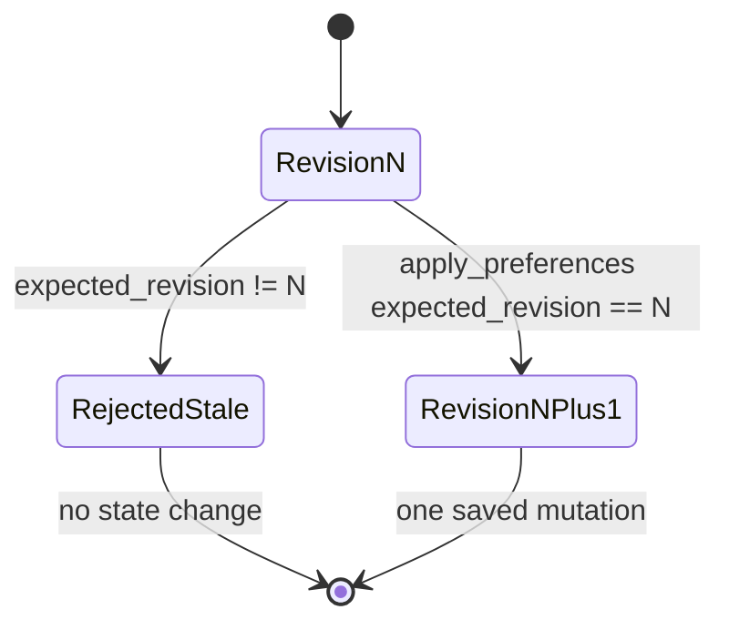

# Luna invariants

These are non-negotiable system rules. An implementation is incorrect even when its local test
passes if it violates one of them. See [architecture.md](architecture.md) for the connected
system and [decisions.md](decisions.md) for the trade-offs behind these rules.

## Identity and evidence

| ID | Invariant | Enforced by |
|---|---|---|
| I-01 | Every selected product is an exact `(listing_id, variant_id)` pair; `item_key` is `listing_id:variant_id`. | `contracts/evidence.py`, `decision/comparisons.py` |
| I-02 | Sibling-variant evidence never becomes evidence for the selected variant. | Evidence indexing/validation and contract relationship checks |
| I-03 | A supported fact has a value and at least one valid exact-item evidence ID. | `Fact.check_status` |
| I-04 | Missing, conflicting or unresolved facts assert no value. | `Fact.check_status` |
| I-05 | A conflict preserves at least two distinct values and two sources; code never silently picks one. | `Fact.check_status`, evidence validator |
| I-06 | Review mentions are exact-SKU literal excerpts with a valid review source. | `ComparisonEvidence.check_relationships` |
| I-07 | Evidence is immutable after comparison creation. Preference changes never re-extract or rewrite it. | `ComparisonResponse` replacement in `apply_preferences` preserves evidence |
| I-08 | Raw listing/review pages remain server-side. Tools return bounded normalized facts or explicitly requested evidence. | `decision/tools.py` |

## State and decisions

| ID | Invariant | Enforced by |
|---|---|---|
| I-09 | One `DemoSessionState` owns each comparison, conversation and Live relay. Another session sees a not-found result. | `routes/session_auth.py`, `decision/sessions.py` |
| I-10 | The server owns the one-hour session expiry and comparison revision. | `decision/sessions.py` |
| I-11 | `apply_preferences` is the only comparison mutation. | `decision/tools.py`, four-tool allowlist |
| I-12 | A mutation requires the current `expected_revision` and increments the revision exactly once. | `apply_preferences`, `RevisionConflict` |
| I-13 | Stale intent never overwrites a newer committed state. | Revision check before mutation |
| I-14 | Ranking is deterministic over stored evidence and explicit preferences. The model never computes or overrides the winner. | `decision/ranking.py` |
| I-15 | Hard constraints run before ordered objective priorities. Missing required facts create uncertainty, not a guessed score. | `rank_comparison` |
| I-16 | With no objective priority or an objective tie, there is no invented winner. | `rank_comparison` |
| I-17 | Review reliability is explanatory evidence, not a numeric ranking score. | `rank_comparison` |

## Agent and tool execution

| ID | Invariant | Enforced by |
|---|---|---|
| I-18 | Text and Live use the same four schemas and the same Python executor. | `openai/text_agent.py`, `openai/live_agent.py` |
| I-19 | Only `get_comparison`, `get_review_aspect`, `inspect_evidence` and `apply_preferences` are callable. | Strict tool schema and `execute_luna_tool` allowlist |
| I-20 | Tool arguments are bound to the authorized comparison and validated again in Python. | Tool schema enums and Pydantic argument models |
| I-21 | `parallel_tool_calls=false`; one turn/delegation cannot mutate twice. In text, `apply_preferences` is the final tool and the continuation uses `tool_choice: "none"`. | Model configuration and mutation guard |
| I-22 | Product-specific answer citations must exist in stored evidence or review mentions. Unsupported IDs are removed with a conservative answer. | `_safe_answer` |
| I-23 | Conversation history contains at most four successful text turns and is permanently bound to one comparison. | `ConversationState`, `_conversation_history` |
| I-24 | Private provider IDs, reasoning and credentials are never returned through application response contracts. | Response models and projection at routes |

## External calls and failures

| ID | Invariant | Enforced by |
|---|---|---|
| I-25 | SDK retries are disabled. A failure never triggers another model, provider or transport strategy. | Runtime clients use `max_retries=0` |
| I-26 | One text turn makes at most four Responses calls. | Three tool rounds plus one initial call |
| I-27 | Live start makes one session-create call and one sideband attach. | `start_live_session` |
| I-28 | One Live delegation executes at most three tool calls and deduplicates provider `call_id`. | `run_live_sideband` |
| I-29 | Live executes only completed function-call items, never argument deltas. | Sideband event filter |
| I-30 | State is committed before a function-call output claims that mutation succeeded. | Text/Live tool loops |
| I-31 | Any typed text-provider failure or invalid response after mutation is non-retryable and includes the committed revision; the client refreshes instead of repeating intent. | Agent exceptions and HTTP mapping |
| I-32 | Expected external failures have one typed boundary and explicit behavior. Programmer errors raise. | Evidence failure handling and `app.errors` |
| I-33 | Streamed or partial provider output is not durable state. Only validated completed output is used. | Response/status validation |

## Live-specific ownership

| ID | Invariant | Enforced by |
|---|---|---|
| I-34 | The server sideband is the only Live tool executor. The browser handles media and captions only. | Live design and `live_agent.py` |
| I-35 | A Live call ID executes once. Duplicate events do not duplicate mutation. | `processed_call_ids` |
| I-36 | After mutation, Live refreshes tool schemas and UI context to the saved revision. | `session.update` after `apply_preferences` |
| I-37 | A sideband error closes the connection and does not switch to a browser executor. | `run_live_sideband` failure path |

## Security and privacy

| ID | Invariant | Enforced by |
|---|---|---|
| I-38 | `OPENAI_API_KEY` is server-only and never a `VITE_*` value, response field or build argument. | Environment boundary and response contracts |
| I-39 | Session tokens are opaque random values; failures never echo them. | `create_demo_session`, stable errors |
| I-40 | The demo uses labelled synthetic marketplace/review data and claims no live Shopee authorization. | `MockCatalogProvider`, fixture documentation |
| I-41 | Logs are projections, not state. Logs may include request/comparison/session IDs and measured decisions, never keys or SDP. | Boundary logging policy |

## Evaluation integrity

| ID | Invariant | Enforced by |
|---|---|---|
| I-42 | Ordinary tests make no paid provider calls. | Injected SDK-shaped responses and separate paid CLIs |
| I-43 | Paid evaluation requires explicit `--live`, has a structural request ceiling and never retries. | `eval/run.py`, `eval/agent.py` |
| I-44 | Test-double output is never written as a measured benchmark artifact. | Test-only call sites and fixed production artifact paths |
| I-45 | Missing observations remain unavailable; they are never reported as zero. | Evaluation report models |
| I-46 | Agent artifacts are rejected when the evidence, scenario suite or text-agent implementation hash changes. A stale artifact is unavailable, never current. | `load_agent_benchmark`, `eval.run` |
| I-47 | Failed measured scenarios remain in the report; a different prompt/model run is not a fallback repair. | Agent evaluator status and artifact |

## Seller report projection

| ID | Invariant | Enforced by |
|---|---|---|
| I-48 | A seller gap report aggregates current comparisons from every active demo session and appears only on a seller page, never in the buyer widget. It exposes counts and public listing evidence, never buyer identity, conversation, budget or preferences. | `routes/listings.py`, `decision/gap_report.py`, `SellerGapReport`, Seller Centre Playwright test |
| I-49 | Structured decision reasons have one owner in `rank_comparison` and are required in memory, but cannot serialize into existing comparison responses, OpenAPI `Recommendation`, text-agent tool/input JSON or Live context. | `Recommendation` fields with `Field(exclude=True)` and boundary tests |
| I-50 | Both browser hosts import the same `@luna/widget` package; widget source imports neither host and receives only the public adapter. | npm workspace, Playwright import-boundary test |
| I-51 | The browser owns microphone, remote playback, captions and connection controls; the server sideband is the only Live tool executor. | `LiveVoiceControls.jsx`, `live_agent.py` |
| I-52 | Provisional transcript fragments never mutate comparison state. The browser refreshes server-owned state only after confirmed Live lifecycle/backend completion events. | Live event handler and deterministic WebRTC browser test |
| I-53 | Live is not marked connected before `session.started`, and Stop does not release the transport as successfully finalized before `session.closed`. | `LiveVoiceControls.jsx`, graceful-close Playwright test |
| I-54 | The seller browser view renders the report response without recounting or reinterpreting decision reasons. It uses the current widget bearer token and the existing evidence panel; neither host owns a second seller implementation. | `SellerGapReport.jsx`, `LunaWidget.jsx`, dual-host Playwright journey |
| I-55 | Host A has one comparison owner: `@luna/widget`. Its cart holds only canonical catalog IDs and quantities, renders titles and prices from `/api/catalog` and hands ticked IDs to the widget through `getCurrentSelections()`; `src/compare` is absent, and the browser contains no model key field, direct OpenAI request or independent ranking path. | Thin `Compare.jsx` route and Playwright source-boundary assertion |
| I-56 | The widget's product snapshot lists the server-owned price breakdown and every `schema_fields` specification from the existing comparison. Every listed price component and supported/conflicting specification retains exact evidence source text and location; delivered total is labelled as arithmetic over its cited components; missing/unresolved values have no invented citation. Host B renders that snapshot with no external call. Host A opens its storefront product page from the snapshot's listing/variant IDs with one catalog GET and no model call. Opening or closing either view keeps the widget mounted and does not change the comparison revision. | `productSnapshot`, Host B preview, Host A product overlay and dual-host Playwright assertions |
| I-57 | Host A's search, product page, cart and checkout render only Luna's backend catalog (`/api/catalog`, `/api/catalog/{listing_id}`) and never submit storefront text as evidence. The product page shows seller text and reviews as the listing's own claims, never as Luna's verified values. Checkout charges each listing's voucher and shipping once per line, so one unit equals Luna's delivered total; it offers cash on delivery only and calls no payment API. | `shop.jsx`, `ProductPage.jsx`, `Checkout.jsx`, Host A search/product/checkout Playwright tests |
| I-58 | While a host-handed comparison (2–4 picks) is being built, the widget shows those products loading and never the picker; if building fails, the picker returns with the same picks. `requestAddToCart` is called only from an explicit **Choose this one** press and must resolve to `{ ok: boolean }`. | `LunaWidget.jsx`, Host A cart Playwright test with a held comparison request |

## Ownership invariants

| State or decision | Sole owner |
|---|---|
| Evidence fields, statuses and provenance | A evidence contract/pipeline |
| Catalog identity and snapshots | `CatalogProvider` |
| Demo-session lifetime and contents | B session store |
| Preferences, recommendation and revision | B decision layer |
| Ranking outcome | Deterministic `rank_comparison` |
| Seller gap report | Pure `build_gap_report` projection over every active session's comparisons |
| HTTP error wording/status | `app.errors` |
| Text/Live model invocation | B OpenAI modules |
| Browser rendering and media | C frontend |
| Measured evaluation artifacts | Explicit paid evaluator CLIs |

## Incomplete gates and declared demo boundaries

These are current repository facts, not accepted implementation shortcuts:

1. One real spoken provider turn produced captions and a visible revision 0→1, but no audible
   output. G4 failed and voice is excluded from the main demo; generation versus browser
   playback was not isolated and must not be guessed.
2. The single-origin Docker/deployment shape and public smoke proof are not implemented.
3. Host A's demo cart contents are three hardcoded canonical catalog variants; no real
   marketplace cart is connected. A future authorized marketplace integration must supply
   canonical identities rather than infer or hardcode a mapping from its own product IDs.

The canonical local text flow is end-to-end tested. These remaining boundaries must still be
stated in the pitch and deployment report.
