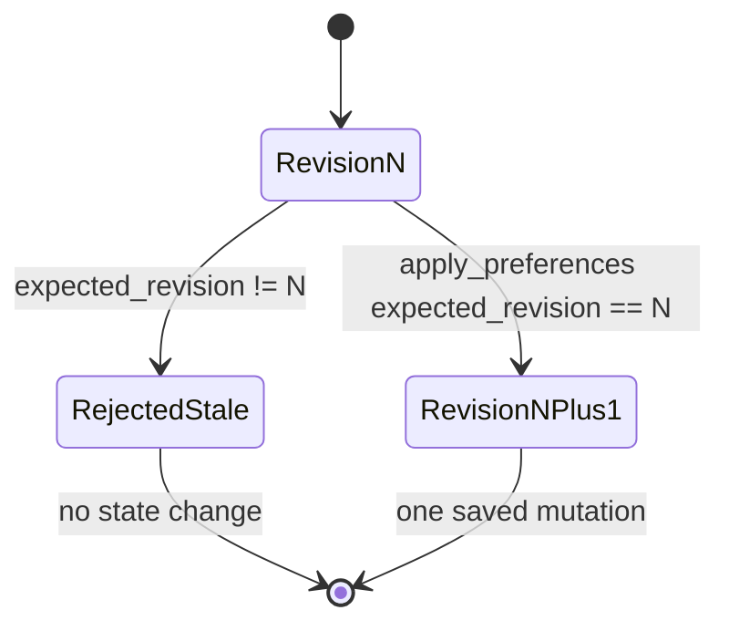

# Luna invariants

These are non-negotiable system rules. An implementation is incorrect even when its local test
passes if it violates one of them. See [architecture.md](architecture.md) for the connected
system and [decisions.md](decisions.md) for the trade-offs behind these rules.

## Identity and evidence

| ID | Invariant | Enforced by |
|---|---|---|
| I-01 | Every selected product is an exact `(listing_id, variant_id)` pair; `item_key` is `listing_id:variant_id`. | `contracts/evidence.py`, `decision/comparisons.py` |
| I-02 | Sibling-variant evidence never becomes evidence for the selected variant. | Evidence indexing/validation and contract relationship checks |
| I-03 | A supported fact has a value and at least one valid exact-item evidence ID. | `Fact.check_status` |
| I-04 | Missing, conflicting or unresolved facts assert no value. | `Fact.check_status` |
| I-05 | A conflict preserves at least two distinct values and two sources; code never silently picks one. | `Fact.check_status`, evidence validator |
| I-06 | Review mentions are exact-SKU literal excerpts with a valid review source. | `ComparisonEvidence.check_relationships` |
| I-07 | Evidence is immutable after comparison creation. Preference changes never re-extract or rewrite it. | `ComparisonResponse` replacement in `apply_preferences` preserves evidence |
| I-08 | Raw listing/review pages remain server-side. Tools return bounded normalized facts or explicitly requested evidence. | `decision/tools.py` |

## State and decisions

| ID | Invariant | Enforced by |
|---|---|---|
| I-09 | One `DemoSessionState` owns each comparison, conversation and Live relay. Another session sees a not-found result. | `routes/session_auth.py`, `decision/sessions.py` |
| I-10 | The server owns the one-hour session expiry and comparison revision. | `decision/sessions.py` |
| I-11 | `apply_preferences` is the only comparison mutation. | `decision/tools.py`, four-tool allowlist |
| I-12 | A mutation requires the current `expected_revision` and increments the revision exactly once. | `apply_preferences`, `RevisionConflict` |
| I-13 | Stale intent never overwrites a newer committed state. | Revision check before mutation |
| I-14 | Ranking is deterministic over stored evidence and explicit preferences. The model never computes or overrides the winner. | `decision/ranking.py` |
| I-15 | Hard constraints run before ordered objective priorities. Missing required facts create uncertainty, not a guessed score. | `rank_comparison` |
| I-16 | With no objective priority or an objective tie, there is no invented winner. | `rank_comparison` |
| I-17 | Review reliability is explanatory evidence, not a numeric ranking score. | `rank_comparison` |

## Agent and tool execution

| ID | Invariant | Enforced by |
|---|---|---|
| I-18 | Text and Live use the same four schemas and the same Python executor. | `openai/text_agent.py`, `openai/live_agent.py` |
| I-19 | Only `get_comparison`, `get_review_aspect`, `inspect_evidence` and `apply_preferences` are callable. | Strict tool schema and `execute_luna_tool` allowlist |
| I-20 | Tool arguments are bound to the authorized comparison and validated again in Python. | Tool schema enums and Pydantic argument models |
| I-21 | `parallel_tool_calls=false`; one turn/delegation cannot mutate twice. | Model configuration and mutation guard |
| I-22 | Product-specific answer citations must exist in stored evidence or review mentions. Unsupported IDs are removed with a conservative answer. | `_safe_answer` |
| I-23 | Conversation history contains at most four successful text turns and is permanently bound to one comparison. | `ConversationState`, `_conversation_history` |
| I-24 | Private provider IDs, reasoning and credentials are never returned through application response contracts. | Response models and projection at routes |

## External calls and failures

| ID | Invariant | Enforced by |
|---|---|---|
| I-25 | SDK retries are disabled. A failure never triggers another model, provider or transport strategy. | Runtime clients use `max_retries=0` |
| I-26 | One text turn makes at most four Responses calls. | Three tool rounds plus one initial call |
| I-27 | Live start makes one session-create call and one sideband attach. | `start_live_session` |
| I-28 | One Live delegation executes at most three tool calls and deduplicates provider `call_id`. | `run_live_sideband` |
| I-29 | Live executes only completed function-call items, never argument deltas. | Sideband event filter |
| I-30 | State is committed before a function-call output claims that mutation succeeded. | Text/Live tool loops |
| I-31 | A timeout after mutation is non-retryable; the client refreshes instead of repeating intent. | `LunaAgentTimeout` HTTP mapping |
| I-32 | Expected external failures have one typed boundary and explicit behavior. Programmer errors raise. | Evidence failure handling and `app.errors` |
| I-33 | Streamed or partial provider output is not durable state. Only validated completed output is used. | Response/status validation |

## Live-specific ownership

| ID | Invariant | Enforced by |
|---|---|---|
| I-34 | The server sideband is the only Live tool executor. The browser handles media and captions only. | Live design and `live_agent.py` |
| I-35 | A Live call ID executes once. Duplicate events do not duplicate mutation. | `processed_call_ids` |
| I-36 | After mutation, Live refreshes tool schemas and UI context to the saved revision. | `session.update` after `apply_preferences` |
| I-37 | A sideband error closes the connection and does not switch to a browser executor. | `run_live_sideband` failure path |

## Security and privacy

| ID | Invariant | Enforced by |
|---|---|---|
| I-38 | `OPENAI_API_KEY` is server-only and never a `VITE_*` value, response field or build argument. | Environment boundary and response contracts |
| I-39 | Session tokens are opaque random values; failures never echo them. | `create_demo_session`, stable errors |
| I-40 | The demo uses labelled synthetic marketplace/review data and claims no live Shopee authorization. | `MockCatalogProvider`, fixture documentation |
| I-41 | Logs are projections, not state. Logs may include request/comparison/session IDs and measured decisions, never keys or SDP. | Boundary logging policy |

## Evaluation integrity

| ID | Invariant | Enforced by |
|---|---|---|
| I-42 | Ordinary tests make no paid provider calls. | Injected SDK-shaped responses and separate paid CLIs |
| I-43 | Paid evaluation requires explicit `--live`, has a structural request ceiling and never retries. | `eval/run.py`, `eval/agent.py` |
| I-44 | Test-double output is never written as a measured benchmark artifact. | Test-only call sites and fixed production artifact paths |
| I-45 | Missing observations remain unavailable; they are never reported as zero. | Evaluation report models |
| I-46 | Agent artifacts are rejected when the evidence or scenario-suite hash changes. | `load_agent_benchmark` |
| I-47 | Failed measured scenarios remain in the report; a different prompt/model run is not a fallback repair. | Agent evaluator status and artifact |

## Ownership invariants

| State or decision | Sole owner |
|---|---|
| Evidence fields, statuses and provenance | A evidence contract/pipeline |
| Catalog identity and snapshots | `CatalogProvider` |
| Demo-session lifetime and contents | B session store |
| Preferences, recommendation and revision | B decision layer |
| Ranking outcome | Deterministic `rank_comparison` |
| HTTP error wording/status | `app.errors` |
| Text/Live model invocation | B OpenAI modules |
| Browser rendering and media | C frontend |
| Measured evaluation artifacts | Explicit paid evaluator CLIs |

## Known system-wide violations and incomplete gates

These are current repository facts, not accepted exceptions:

1. `shopee-compare-app/src/compare/engine.js` can call OpenAI directly with a browser-entered
   key. This violates I-24 and I-38 and must be deleted when Host A is wired to the API.
2. Host A computes comparison facts and ranking independently of B's canonical state, violating
   the intended single state/decision owner across the full application.
3. `LunaWidget` is a local prototype and does not execute the API journey.
4. Host B and cross-host portability tests do not exist.
5. Browser microphone/audio/stop controls do not exist, so the full Live invariant chain has
   only backend proof.
6. The single-origin Docker/deployment shape is planned, not implemented.

Until these are fixed, backend correctness must not be presented as end-to-end product
correctness.
