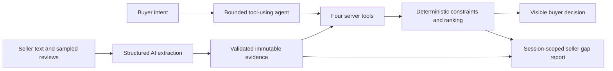

# Luna: evidence-backed shopping decisions for buyers and sellers

## One-line description

Luna is a portable AI shopping-decision layer that turns inconsistent exact-variant listings and
sampled reviews into a cited comparison, applies a buyer's natural-language constraints through
validated tools, and reuses the same evidence to show sellers what to fix.

## The problem

Marketplace comparison is a sequence of manual tasks rather than one decision. A buyer opens
several listings, checks that the selected variants match, translates incompatible units, notices
missing or contradictory claims, scans reviews, applies budget and performance constraints, and
then repeats the work when a priority changes.

A generic chatbot does not solve this safely. It can answer fluently while confusing sibling
variants, treating a missing value as zero, losing the original source, or describing a preference
change without actually changing the product state.

Sellers see the other side of the same problem. They know that shoppers leave, but they do not
know whether a missing attribute, contradictory warranty or hard budget constraint caused the
listing to lose a comparison.

## What Luna changes

Luna creates one immutable evidence graph for the exact selected variants. Each normalized fact
is `supported`, `missing`, `conflicting` or `unresolved`; supported claims retain their original
seller sources, and review mentions retain literal excerpts and review IDs.

The buyer then states a goal such as:

> Under S$80, at least 65W; prioritize portability.

The model translates that intent into one of four allowlisted tools. Deterministic server code
validates the item IDs and revision, applies hard constraints, ranks only comparable values and
returns a canonical state update. A correction such as “Actually prioritize price” updates the
same comparison revision without extracting the listing evidence again.

The same authorized session can open a read-only seller gap report. It shows evidence gaps,
competitors that state the missing field, and current exclusion or uncertainty reasons. It does
not expose the buyer's identity, conversation, budget or preferences and makes no additional
model call.

## Why this is AI-native

Luna uses AI where language understanding is required and deterministic code where authority is
required:

The model never owns product identity, ranking, permissions or React state. Invalid citations,
unknown items and stale revisions fail at explicit boundaries. The buyer remains in control of
cart, checkout and payment.

## What is implemented at the midpoint

- Exact-variant synthetic catalog and immutable evidence contract.
- Structured specification and review extraction with deterministic normalization.
- Source-linked missing, conflict and variant-leakage validation.
- Authenticated process-local demo sessions and canonical comparison revisions.
- Four decision tools shared by the text and Live paths.
- A bounded Responses text agent with no SDK retries and a four-call ceiling per turn.
- One reusable `@luna/widget` package mounted by a Shopee-style Host A and independent Host B.
- Evidence, recommendation, correction and session-scoped seller gap-report UI in both hosts.
- Deterministic API, build and browser gates that spend no model credits.

## Measured results

The evaluation corpus is synthetic and was not independently human-adjudicated. The recorded
grounded evidence run is historical: its source data and predictions were revalidated, but it did
not record a current implementation fingerprint.

| Measurement | Result |
|---|---:|
| Grounded supported fields | 88/88 |
| Grounded evidence precision | 96/96 |
| Grounded missing-field recall | 4/4 |
| Grounded exact normalized conflict recall | 4/4 |
| Grounded variant leakage | 0/12 |
| Grounded review precision / recall | 49/49 / 49/51 |
| Agent scenario success | 10/12 |
| Agent tool behavior | 10/11 |
| Agent state/UI outcome | 11/12 |
| Agent citation behavior | 4/5 |
| Correction / stale-turn protection | 1/1 / 1/1 |

The failed agent scenarios remain visible: one review answer failed citation validation, and one
review-reliability request made a rejected tool call instead of saving a no-winner state. Cost,
matched interaction-friction measurement and a prose-only agent baseline remain unavailable.

At commit `18eb720`, the free verification gates report 194 API tests passing, successful
production builds for both hosts, and five Playwright tests passing with one intentional
duplicate-host skip.

## Business value

For buyers, Luna removes repeated inspection and filtering while keeping uncertainty and original
sources visible. For a marketplace, the portable widget and API separate decision intelligence
from any one storefront. For sellers, the same evidence produces a concrete catalog-quality fix
list without a second model pipeline.

These are demonstrated workflow benefits. The midpoint prototype does not establish conversion,
GMV, return-rate or customer-support improvements.

## Evidence against the judging criteria

| Criterion | Midpoint evidence |
|---|---|
| Problem and solution fit | One continuous exact-variant workflow replaces repeated listing, review, filter and correction work. |
| Build quality | Typed evidence and session contracts, explicit failure states, 194 API tests, two production builds and deterministic dual-host browser proof. |
| Insight and originality | AI extracts cited evidence and translates intent into constrained actions; deterministic code retains authority. The same evidence creates a buyer decision and seller fix list. |
| Real-world value | The prototype demonstrates buyer decision support, portable integration and session-scoped catalog-quality insight without claiming unmeasured commercial lift. |
| AI-Native Products & Operations alignment | The visible flow is normalize → inspect → constrain → act → correct, followed by an operations projection for the seller. |
| Use of Codex | Separate developer streams used Codex for architecture, contracts, implementation, adversarial tests, failure diagnosis and measured evaluation, with human corrections preserved in build logs. |

## How Codex contributed

Codex was used as an implementation partner rather than a source of unverified product claims.
The team divided the repository into evidence, decision/API and frontend ownership boundaries.
Within those boundaries, Codex helped implement typed contracts, structured extraction,
deterministic ranking, bounded tool orchestration, portable browser integration and adversarial
tests. Humans corrected contract assumptions, rejected invented paths or metrics, authorized paid
runs separately and kept failed scenarios in the final artifacts.

The evidence is recorded in `docs/codex-build-log/A.md`, `B.md` and `C.md`: each entry names the
task, files, human correction and exact verification outcome. The logs are build provenance, not
a claim that generated code was accepted without review.

## Current limitations

- Data and reviews are fabricated and explicitly synthetic; there is no Shopee API integration.
- Host A still contains a superseded browser comparison/OpenAI path beside Luna.
- The real G4 run captured speech, captions and a revision change but produced no audible Luna
  response. The demo therefore uses text.
- Sessions are stored in one process and disappear on restart. There is no production identity,
  database, seller ownership or cross-session aggregation.
- No public deployment has passed a smoke test.
- The inherited Shopee-style shell/assets require written permission and organizer approval or
  replacement before public distribution.

## Team ownership

- **Developer A — Evidence Intelligence:** contracts, provider fixtures, extraction,
  normalization, review intelligence and evaluation scorecard.
- **Developer B — Decisions and API:** sessions, deterministic ranking, four tools, text/Live
  server paths, seller projection and deployment boundary.
- **Developer C — Product experience:** Host A, shared widget, independent Host B, browser media
  and end-to-end browser proof.

## Next milestone

The midpoint priority is a reliable, text-first submission rather than another feature. C must
make the canonical widget Host A's only comparison path; B can then add the planned single-origin
runtime; the team must rehearse the same demo twice and publish only measured claims. Persistent
personalization, review-disputed claims, landed price and seller-question workflows remain
post-midpoint roadmap work.
