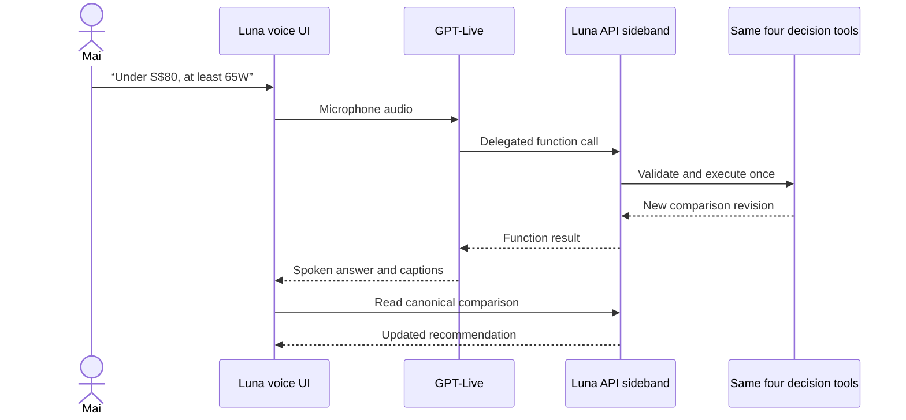
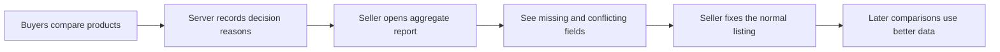

# Luna user stories

This document explains Luna in product language. It is the easiest place to understand
what a buyer does, what changes because AI is present, and what judges can see in the demo.
For implementation details, read [architecture.md](architecture.md). For optional business
extensions, read [luna-business-value-proposals.md](luna-business-value-proposals.md).

## One-sentence product story

Luna turns several inconsistent marketplace listings and their reviews into one
evidence-backed decision that a buyer can constrain, question and correct without reopening
every product page.

## Status legend

The backend and frontend are not yet connected, so each story has an explicit status.

| Status | Meaning |
|---|---|
| **Backend ready** | The API behavior exists and has automated tests, but Host A does not render it yet. |
| **Integration required** | Developer C must connect `shopee-compare-app` to the API before this is an end-to-end product flow. |
| **Planned** | The design exists, but required product code has not been implemented. |

Nothing marked **Backend ready** should be pitched as a working browser experience until its
corresponding **Integration required** step passes.

## The complete buyer journey

Persona: Mai needs a power bank for weekly travel. She has a budget, needs laptop charging,
and cares about portability. The sellers describe similar products in different ways, and
some fields are missing or contradictory.

```mermaid
flowchart LR
    Need[Mai has a shopping need]
    Select[Select exact variants]
    Compare[See one normalized comparison]
    Verify[Open seller evidence]
    Reviews[Inspect aligned review themes]
    Ask[State budget and needs]
    Decide[Luna filters and recommends]
    Correct[Mai corrects a priority]
    Update[Same comparison updates]
    Act[Open the chosen listing]

    Need --> Select --> Compare --> Verify --> Reviews --> Ask --> Decide --> Correct --> Update --> Act
```

### 1. Build a comparison bucket

**User story:** As Mai, I want to add the exact variants I am considering so that Luna never
compares the wrong capacity, colour or power configuration.

1. Mai opens the existing Shopee-style storefront.
2. She selects a specific variant from each of three power-bank listings.
3. She adds those variants to a comparison bucket with a maximum of four items.
4. She opens Compare and sees the exact selected variant names.

**Value:** Mai no longer keeps three product tabs and a mental shortlist.

**Success looks like:** Changing a variant changes its variant ID. A missing variant is
rejected rather than silently replaced by a default or sibling variant.

**Status:** **Backend ready** for validating exact listing/variant IDs. **Integration
required** for Host A to send its selection to the API.

### 2. Turn incompatible listings into one table

**User story:** As Mai, I want seller descriptions normalized into the same fields so that I
can compare like with like.

1. Luna reads the saved seller evidence for only the selected variants.
2. It maps the listings into the same eight comparison fields.
3. It displays supported values, missing fields and conflicts differently.
4. If weight is absent, the table says **missing**. If warranty says both 12 and 24 months,
   the table shows **conflicting** and preserves both statements.

**Value:** Mai does not scan differently formatted descriptions or mistake absent data for
zero.

**Success looks like:** Every supported value opens the original seller snippet. Luna never
guesses through a missing or conflicting value.

**Status:** Evidence generation is **Backend ready**. The normalized table and evidence
drawer are **Integration required**.

### 3. Understand what buyers experienced

**User story:** As Mai, I want reviews grouped by the same shopping concerns so that I do not
read dozens of reviews one by one.

1. Mai opens the Reviews view.
2. She sees aligned aspects such as heat, portability and charging reliability for each
   item.
3. Each count includes the number of reviews analysed.
4. She opens an aspect and reads exact review excerpts with their review IDs.
5. Luna describes only the analysed sample; it does not claim a real-world failure rate.

**Value:** Repetitive review reading becomes one comparable view without hiding the source
material.

**Success looks like:** Every review claim can be traced to an exact excerpt, and an invalid
excerpt is not displayed.

**Status:** Review evidence is **Backend ready**. The browser review view is **Integration
required**.

### 4. State the decision instead of manipulating filters

**User story:** As Mai, I want to describe my constraints naturally so that I do not translate
my trip into many product filters.

Mai types:

> Under S$80, at least 65W, prioritize portability.

Luna then:

1. reads the current comparison;
2. validates the requested budget, minimum output and priorities;
3. applies the hard constraints deterministically;
4. ranks the remaining comparable items;
5. keeps candidates with missing priority data visibly uncertain; and
6. answers with citations that belong to this comparison.

**Value:** One sentence replaces repeated filtering, rescanning and remembering.

**Success looks like:** The UI visibly excludes items that fail hard constraints, focuses the
relevant rows and explains the recommendation. The model does not choose the winner; it calls
the server-owned decision tools.

**Status:** The four tools, ranking and bounded Responses agent are **Backend ready**. Chat,
visible tool activity and UI mutation are **Integration required**.

### 5. Correct the decision without starting over

**User story:** As Mai, I want to change my mind in ordinary language so that the comparison
updates without another evidence-extraction run.

Mai types:

> Actually, price matters more than portability.

1. Luna applies the new priority order to the same comparison.
2. The server increments the comparison revision.
3. The evidence stays unchanged.
4. The recommendation and focused rows update.
5. Any response based on an older revision is rejected instead of overwriting Mai's newer
   choice.

**Value:** Correction is a first-class interaction, not a reset button or a second shopping
session.

**Success looks like:** The visible recommendation changes and the revision increases, while
the cited source material remains the same.

**Status:** Revision-safe correction is **Backend ready**. Applying the returned UI patch and
rejecting a stale patch in React are **Integration required**.

### 6. Continue to the marketplace action

**User story:** As Mai, I want to return to the original listing after deciding so that Luna
helps me choose without taking over checkout.

1. Mai opens the recommended listing through the host's normal navigation.
2. Luna does not add to cart or buy without an explicit user action.
3. The existing marketplace owns cart, checkout, payment and fulfilment.

**Value:** Luna removes decision work while keeping the buyer in control of the commercial
action.

**Status:** **Planned** as part of the Host A adapter. Checkout automation is intentionally
out of scope.

## The same decision by voice

Persona and decision are unchanged; only the input and output channel changes.

**User story:** As Mai, I want to speak and correct my constraints while looking at the table
so that I can keep my attention on the products.

The server-side Live path already delegates to the same tools used by text. The missing
browser work is microphone capture, remote audio, captions, start/mute/stop controls and
rendering the new comparison revision.

**Status:** Live session creation and one server-side tool executor are **Backend ready**.
The real microphone-to-visible-mutation story is **Integration required** and must not be
demoed as working until tested end to end.

## The portability story

**User story:** As a marketplace team, we want to embed the same Luna decision experience in
a different storefront without rebuilding its evidence, ranking or model integration.

1. Host A supplies its selected listing and variant IDs through a small host adapter.
2. The shared Luna widget calls the same Luna API with relative `/api` URLs.
3. Host B supplies the same adapter from a visually unrelated minimal storefront.
4. Both hosts render the same evidence and decision state; only their shells and navigation
   differ.

**Value:** Luna is a portable marketplace decision layer rather than a one-page prototype.

**Success looks like:** The same Playwright journey passes in both hosts without changing the
widget or API to add Host B.

**Status:** **Planned.** The shared widget package and independent Host B do not yet exist.

## Seller operations extension

This is Proposal 1 from
[luna-business-value-proposals.md](luna-business-value-proposals.md). It extends the same
evidence into a business-facing result; it is not part of the currently implemented system.

Persona: Linh sells one of the compared power banks.

1. Buyers compare Linh's listing during normal shopping journeys.
2. Luna records only decision outcomes such as missing weight, warranty conflict or over
   budget.
3. Linh opens a read-only report for her own listing.
4. She sees which evidence gaps and exclusion reasons repeatedly hurt the listing.
5. She opens the exact conflicting snippets from her own public listing.
6. She fixes the listing in the normal seller editor; Luna edits nothing.
7. Future comparisons read the improved listing.

**Business value:** One evidence system produces a defensible buyer decision and a catalog
quality fix list. Sellers do less guesswork, while a marketplace can improve attributes,
filters and discovery without manual listing audits.

**Privacy rule:** Sellers see aggregate reason counts and public listing evidence, never a
buyer's identity, conversation, budget or preferences.

**Status:** **Planned.** No gap-report route, aggregation or seller UI currently exists.

## What the judge should see

This is the intended 75–90 second product flow after Host A integration passes.

| Time | Visible action | What to say |
|---|---|---|
| 0–12 s | Add three exact variants to the comparison. | “Marketplace comparison breaks because sellers describe variants differently.” |
| 12–28 s | Show the normalized table; open one quote and one warranty conflict. | “Luna normalizes the evidence, but never guesses through missing or conflicting data.” |
| 28–40 s | Open the heat aspect and an exact review excerpt. | “It turns the reviews we analysed into comparable concerns while keeping every claim inspectable.” |
| 40–58 s | Type the budget, minimum power and portability request. | “The model does not invent a winner. It uses constrained tools, and the server applies the decision rules.” |
| 58–68 s | Correct the priority to price and show the new revision. | “A correction updates the same decision without paying to extract the evidence again.” |
| 68–80 s | Open the same flow in Host B. | “The intelligence is portable; the storefront only supplies an adapter.” |
| 80–90 s | Show measured evaluation results. | “We test evidence, tool behavior and stale-update protection separately, and we keep failed scenarios visible.” |

If the real browser voice path is green, speak the two decision turns instead of typing them.
If it is not green, use text and do not imply that microphone integration works.

## Pitch-ready summary

**Problem:** Comparing marketplace products is not one task. Buyers repeatedly open tabs,
translate inconsistent specs, scan reviews, remember constraints and redo the work when their
priority changes.

**Product:** Luna creates one exact-variant evidence model, exposes uncertainty, and lets a
buyer reach and revise a recommendation through natural language.

**Why it is AI-native:** AI handles the parts that require understanding messy seller and
review language and translating human intent into constrained actions. Deterministic code
owns identity, constraints, ranking, revisions and permissions.

**Why a marketplace cares:** The immediate value is fewer buyer actions and a more defensible
choice. The proposed seller report reuses the same decision evidence to reveal catalog gaps,
creating an operations loop without another model pipeline.

**Honest current claim:** The backend intelligence is implemented and evaluated. The primary
demo is not complete until `shopee-compare-app` replaces its legacy browser comparison path
with this API, and the portability claim is not complete until Host B runs the same journey.
