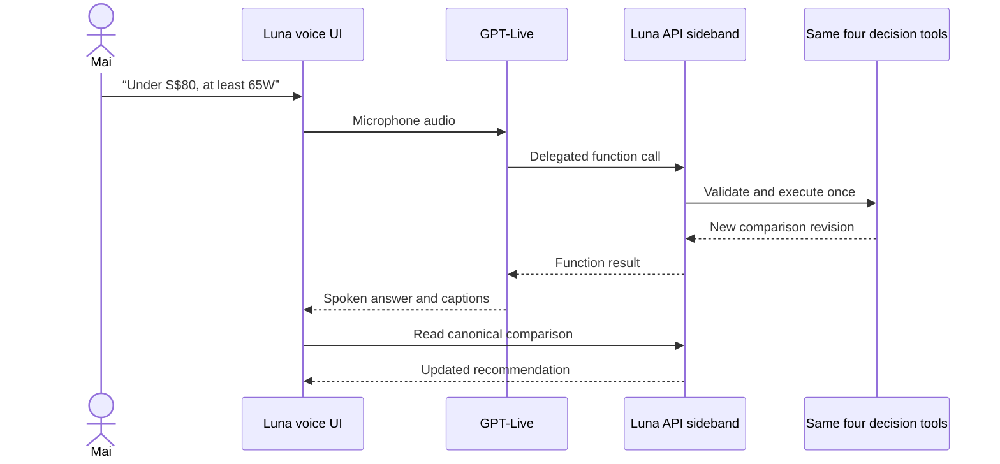
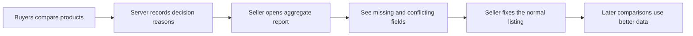

# Luna user stories

This document explains Luna in product language. It is the easiest place to understand
what a buyer does, what changes because AI is present, and what judges can see in the demo.
For implementation details, read [architecture.md](architecture.md). For optional business
extensions, read [luna-business-value-proposals.md](luna-business-value-proposals.md).

## One-sentence product story

Luna turns several inconsistent marketplace listings and their reviews into one
evidence-backed decision that a buyer can constrain, question and correct without reopening
every product page.

## Status legend

The same packaged Luna panel is the only comparison path in Host A and Host B. Each story still
has an explicit status because real voice audio, deployment and some presentation breadth are
not complete.

| Status | Meaning |
|---|---|
| **Backend ready** | The API behavior exists and has automated tests, but Host A does not render it yet. |
| **Browser ready** | The behavior runs in the shared widget and is covered by deterministic browser tests. |
| **Partial** | A working slice exists, but the full required presentation or real external proof is incomplete. |
| **Integration required** | A real cross-boundary acceptance check or replacement remains. |
| **Planned** | The design exists, but required product code has not been implemented. |

Nothing marked **Backend ready** should be pitched as a working browser experience. Offline
Live transport tests are not evidence of a real provider-driven voice mutation.

## Current implementation snapshot

“Complete” below means implemented and covered at that owner’s boundary. A story is ready for
the final demo only when both its backend and browser columns are complete.

| User story | Backend/API | Host A browser | Remaining owner/work |
|---|---|---|---|
| Exact-variant comparison | **Complete** — validates 2–4 canonical variant IDs and builds one comparison | **Browser ready** — both hosts select exact API variants through the sole shared widget | Authorized storefront-to-catalog identity mapping is future integration, not a demo blocker |
| Normalized seller evidence | **Complete** — supported, missing and conflicting facts retain provenance | **Browser ready** — facts and original seller sources render in the sole comparison view in both hosts | No demo blocker |
| Review intelligence | **Complete** — exact-SKU aspects, mentions and excerpts are validated | **Partial** — cited review mentions resolve to excerpts; full cross-product aspect view remains | C: add the required review-aspect presentation |
| Text decision agent | **Complete, current evaluation partial** — bounded tools, citations and deterministic ranking; 10/12 paid scenarios passed | **Browser ready in widget** — ask, citations and canonical refresh pass in both hosts with an injected test model | C: final tool-activity/focused-row presentation |
| Revision-safe correction | **Complete** — optimistic revision and one mutation owner | **Browser ready** — dual-host E2E observes revisions 0→1→2→3 and changed priority/budget | C: add explicit stale-error browser case |
| Voice decision | **Complete server path** — Live session and sideband executor | **Failed demo gate** — real speech produced captions and revision 0→1, but no audible output | Voice cut from demo; generation versus playback cause remains unverified |
| Portable second host | API is host-neutral | **Browser ready** — `@luna/widget` mounts through separate adapters and same-flow Playwright passes | No G3 blocker; real Shopee integration remains out of scope |
| Seller listing gap report | **Complete** — gaps with listing text, supported competitors, exclusion and uncertainty counts across every active session; zero model calls | **Browser ready in Host A Seller Centre** — `SellerGapReport` from the widget package; buyers see no seller UI | Production seller auth, ownership and persistence remain roadmap |

A4 is complete and `eval/results.json` contains the current hash-validated partial agent
artifact. G3 is no longer a blocker. G4 received its one authorized paid run and failed audible
output; it is not part of the main demo.

## The complete buyer journey

Persona: Mai needs a power bank for weekly travel. She has a budget, needs laptop charging,
and cares about portability. The sellers describe similar products in different ways, and
some fields are missing or contradictory.

```mermaid
flowchart LR
    Need[Mai has a shopping need]
    Select[Select exact variants]
    Compare[See one normalized comparison]
    Verify[Open seller evidence]
    Reviews[Inspect aligned review themes]
    Ask[State budget and needs]
    Decide[Luna filters and recommends]
    Correct[Mai corrects a priority]
    Update[Same comparison updates]
    Act[Open the chosen listing]

    Need --> Select --> Compare --> Verify --> Reviews --> Ask --> Decide --> Correct --> Update --> Act
```

### 1. Build a comparison bucket

**User story:** As Mai, I want to add the exact variants I am considering so that Luna never
compares the wrong capacity, colour or power configuration.

1. Mai opens the existing Shopee-style storefront and chooses **Compare now**.
2. Luna loads the trusted backend catalog on the comparison page.
3. She selects a specific variant from each of three power-bank listings.
4. She compares a bucket of at most four items and sees the exact selected variant names.

**Value:** Mai no longer keeps three product tabs and a mental shortlist.

**Success looks like:** Changing a variant changes its variant ID. A missing variant is
rejected rather than silently replaced by a default or sibling variant.

**Status:** **Browser ready.** The sole comparison view selects exact variants from the API
catalog in both hosts. Host A's clone cart is presentation-only; a real marketplace adapter
must provide authorized canonical identities before cart-to-Luna preselection is added.

### 2. Turn incompatible listings into one table

**User story:** As Mai, I want seller descriptions normalized into the same fields so that I
can compare like with like.

1. Luna reads the saved seller evidence for only the selected variants.
2. It maps the listings into the same eight comparison fields.
3. It displays supported values, missing fields and conflicts differently.
4. If weight is absent, the table says **missing**. If warranty says both 12 and 24 months,
   the table shows **conflicting** and preserves both statements.

**Value:** Mai does not scan differently formatted descriptions or mistake absent data for
zero.

**Success looks like:** Every supported value opens the original seller snippet. Luna never
guesses through a missing or conflicting value.

**Status:** **Browser ready in the shared widget.** Evidence and seller sources render in the
sole comparison view in both hosts.

### 3. Understand what buyers experienced

**User story:** As Mai, I want reviews grouped by the same shopping concerns so that I do not
read dozens of reviews one by one.

1. Mai opens the Reviews view.
2. She sees aligned aspects such as heat, portability and charging reliability for each
   item.
3. Each count includes the number of reviews analysed.
4. She opens an aspect and reads exact review excerpts with their review IDs.
5. Luna describes only the analysed sample; it does not claim a real-world failure rate.

**Value:** Repetitive review reading becomes one comparable view without hiding the source
material.

**Success looks like:** Every review claim can be traced to an exact excerpt, and an invalid
excerpt is not displayed.

**Status:** **Partial.** Review-mention citations now open their canonical excerpts in both
hosts. The dedicated cross-product aspect/count view is still missing.

### 4. State the decision instead of manipulating filters

**User story:** As Mai, I want to describe my constraints naturally so that I do not translate
my trip into many product filters.

Mai types:

> Under S$80, at least 65W, prioritize portability.

Luna then:

1. reads the current comparison;
2. validates the requested budget, minimum output and priorities;
3. applies the hard constraints deterministically;
4. ranks the remaining comparable items;
5. keeps candidates with missing priority data visibly uncertain; and
6. answers with citations that belong to this comparison.

**Value:** One sentence replaces repeated filtering, rescanning and remembering.

**Success looks like:** The UI visibly excludes items that fail hard constraints, focuses the
relevant rows and explains the recommendation. The model does not choose the winner; it calls
the server-owned decision tools.

**Status:** **Browser ready in the shared widget.** The deterministic two-host gate proves the
tool-backed state and citations; the current paid agent evaluation remains honestly 10/12.

### 5. Correct the decision without starting over

**User story:** As Mai, I want to change my mind in ordinary language so that the comparison
updates without another evidence-extraction run.

Mai types:

> Actually, price matters more than portability.

1. Luna applies the new priority order to the same comparison.
2. The server increments the comparison revision.
3. The evidence stays unchanged.
4. The recommendation and focused rows update.
5. Any response based on an older revision is rejected instead of overwriting Mai's newer
   choice.

**Value:** Correction is a first-class interaction, not a reset button or a second shopping
session.

**Success looks like:** The visible recommendation changes and the revision increases, while
the cited source material remains the same.

**Status:** **Browser ready for successful correction.** Both hosts visibly move from revision
0 to 1 to 2. A dedicated stale-error browser case remains.

### 6. Continue to the marketplace action

**User story:** As Mai, I want to inspect the exact product after deciding so that Luna helps me
choose without taking over checkout.

1. Mai opens the host's product view for the exact listing and variant she compared.
2. She sees delivered total plus its list price, shop voucher and shipping components, followed
   by every normalized specification, including missing and conflicting states.
3. Every listed price component and every supported or conflicting specification shows the exact
   seller excerpt and source location; the delivered total says it is calculated from those
   cited components.
4. Missing values say no verified source exists rather than inventing one.
5. Luna does not add to cart or buy without an explicit user action.
6. The existing marketplace owns cart, checkout, payment and fulfilment.

**Value:** Luna removes decision work while keeping the buyer in control of the commercial
action.

**Status:** **Browser ready for the demo boundary.** **View product** passes the exact canonical
snapshot, the four delivered-price amounts and all eight normalized specifications to each host.
Exact evidence excerpts and locations render for the three listed price components and every
supported/conflicting fact; delivered total is explicitly derived, while missing facts abstain.
The view opens and closes without another API/model call or comparison reset. It is labelled
synthetic where applicable. A real authorized marketplace product URL and checkout automation
remain out of scope.

## The same decision by voice

Persona and decision are unchanged; only the input and output channel changes.

**User story:** As Mai, I want to speak and correct my constraints while looking at the table
so that I can keep my attention on the products.

The server-side Live path delegates to the same tools used by text. The shared widget now owns
microphone capture, remote audio, provisional captions, start/mute/stop, graceful close and a
canonical refresh after confirmed Live events.

**Status:** The server and browser pieces are implemented, and deterministic Playwright proves
transport wiring plus microphone-denied fallback. One authorized real microphone turn produced
captions and changed the canonical comparison from revision 0 to 1, but no audible Luna response
was heard. G4 therefore failed. It was not retried and must not be demoed as working voice.

## The portability story

**User story:** As a marketplace team, we want to embed the same Luna decision experience in
a different storefront without rebuilding its evidence, ranking or model integration.

1. Host A supplies a small navigation adapter; the widget owns trusted catalog selection.
2. The shared Luna widget calls the same Luna API with relative `/api` URLs.
3. Host B supplies the same adapter from a visually unrelated minimal storefront.
4. Both hosts render the same evidence and decision state; only their shells and navigation
   differ.

**Value:** Luna is a portable marketplace decision layer rather than a one-page prototype.

**Success looks like:** The same Playwright journey passes in both hosts without changing the
widget or API to add Host B.

**Status:** **Browser ready.** Host A and independent Host B use the same package and API; the
same two-turn Playwright journey passes in both, and the package imports neither host.

## Seller operations extension

This is Proposal 1 from
[luna-business-value-proposals.md](luna-business-value-proposals.md). Its read-only
demo-session backend and shared dual-host browser view are implemented.

Persona: Linh sells one of the compared power banks.

1. Buyers compare Linh's listing during normal shopping journeys.
2. Luna records only decision outcomes such as missing weight, warranty conflict or over
   budget.
3. Linh opens a read-only report for her own listing.
4. She sees which evidence gaps and exclusion reasons repeatedly hurt the listing.
5. She opens the exact conflicting snippets from her own public listing.
6. She fixes the listing in the normal seller editor; Luna edits nothing.
7. Future comparisons read the improved listing.

**Business value:** One evidence system produces a defensible buyer decision and a catalog
quality fix list. Sellers do less guesswork, while a marketplace can improve attributes,
filters and discovery without manual listing audits.

**Privacy rule:** Sellers see aggregate reason counts and public listing evidence, never a
buyer's identity, conversation, budget or preferences.

**Status:** **Demo flow ready.** `GET /api/listings/{listing_id}/gap-report` projects current
comparison states from every active demo session and makes zero model calls. Host A's top-bar
**Seller Centre** opens the seller page; buyers never see seller UI. Seller login, listing
ownership and persistence are not implemented, and restarting the API clears the counts.

## What the judge should see

This is the intended 75–90 second text product flow. Host A's `#/Compare` route mounts the
shared widget directly; there is no second comparison engine.

| Time | Visible action | What to say |
|---|---|---|
| 0–12 s | Add three exact variants to the comparison. | “Marketplace comparison breaks because sellers describe variants differently.” |
| 12–28 s | Show the normalized table; open one quote and one warranty conflict. | “Luna normalizes the evidence, but never guesses through missing or conflicting data.” |
| 28–40 s | Open the heat aspect and an exact review excerpt. | “It turns the reviews we analysed into comparable concerns while keeping every claim inspectable.” |
| 40–58 s | Type the budget, minimum power and portability request. | “The model does not invent a winner. It uses constrained tools, and the server applies the decision rules.” |
| 58–70 s | Correct to price, set S$70, then click **Seller Centre** in the top bar and choose the Comet listing; point at the two warranty sentences. | “The buyer got a decision; the seller got a fix list from the same evidence, with no extra model call. These counts cover every buyer comparison on this demo server.” |
| 70–82 s | Open the same flow in Host B. | “The intelligence is portable; the storefront only supplies an adapter.” |
| 82–90 s | Show measured evaluation results. | “We test evidence, tool behavior and stale-update protection separately, and we keep failed scenarios visible.” |

Use text for the decision turns. The real browser voice gate failed audible output, so do not
imply that microphone integration is demo-ready.

## Pitch-ready summary

**Problem:** Comparing marketplace products is not one task. Buyers repeatedly open tabs,
translate inconsistent specs, scan reviews, remember constraints and redo the work when their
priority changes.

**Product:** Luna creates one exact-variant evidence model, exposes uncertainty, and lets a
buyer reach and revise a recommendation through natural language.

**Why it is AI-native:** AI handles the parts that require understanding messy seller and
review language and translating human intent into constrained actions. Deterministic code
owns identity, constraints, ranking, revisions and permissions.

**Why a marketplace cares:** The immediate value is fewer buyer actions and a more defensible
choice. The seller report reuses the same decision evidence to reveal catalog gaps, creating an
operations loop without another model pipeline.

**Honest current claim:** The backend intelligence is implemented and evaluated, and one shared
widget completes the same cited buyer decision, correction and demo-session seller-report
journey in two independent hosts. Host A's superseded browser comparison path is deleted.
Deployment is incomplete, and voice stays out of the main demo because the real run had no
audible output even though captions and mutation worked.
